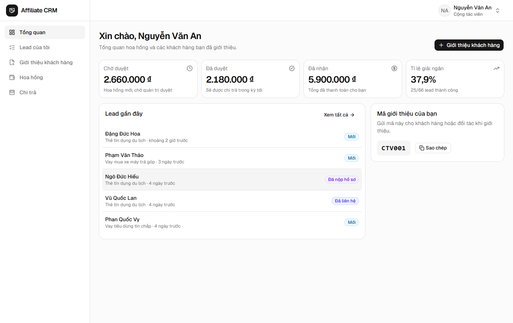
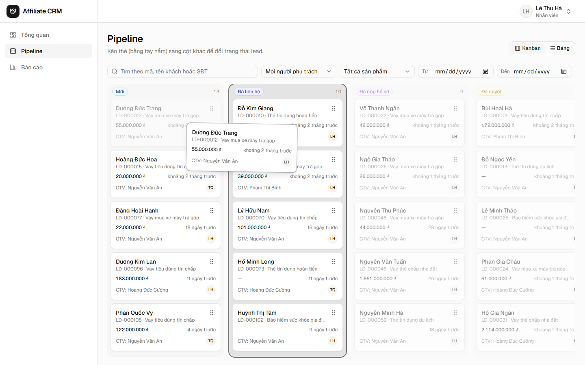
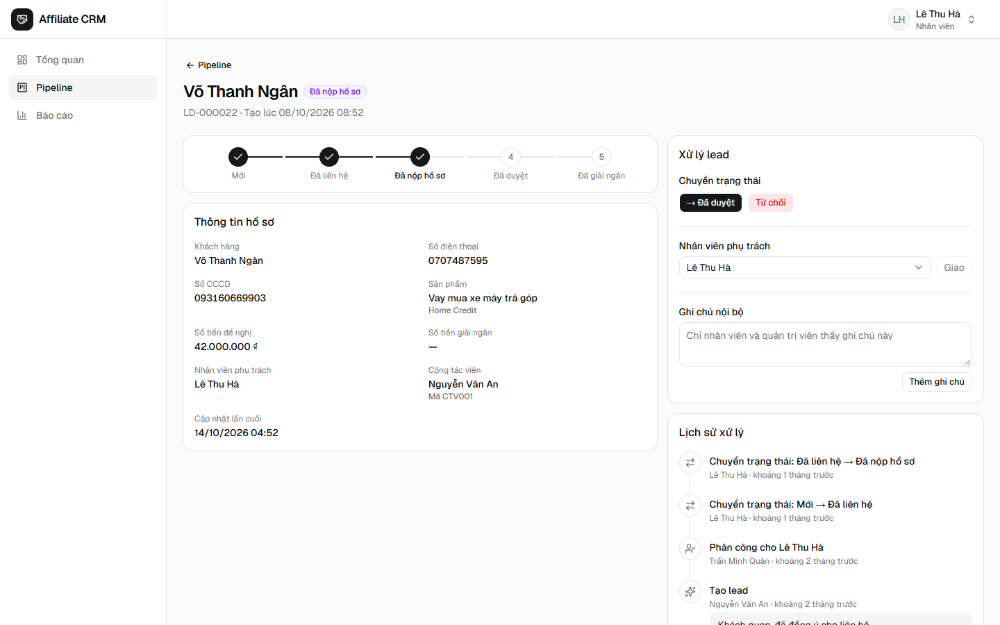
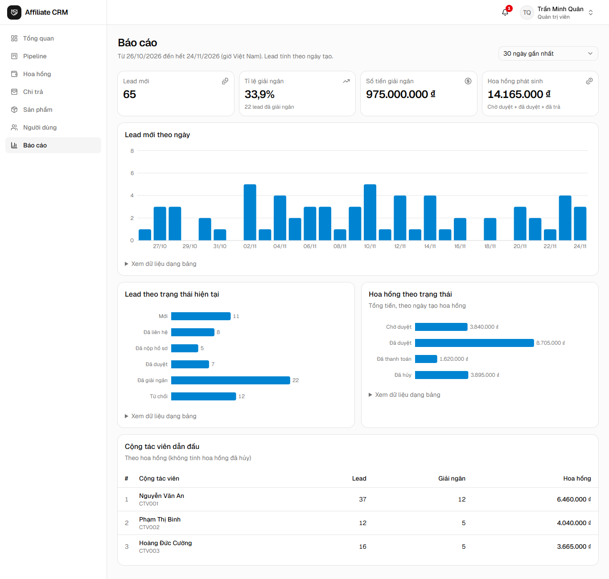
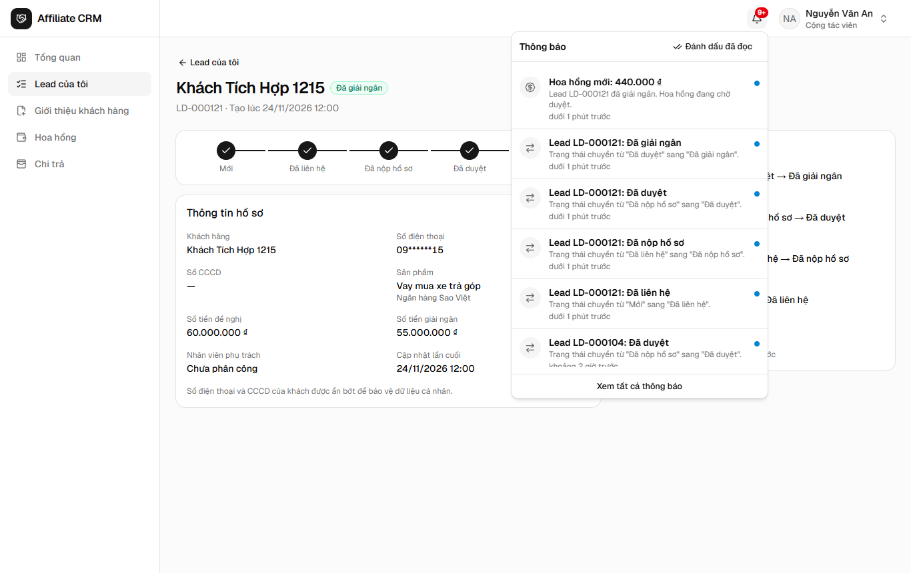
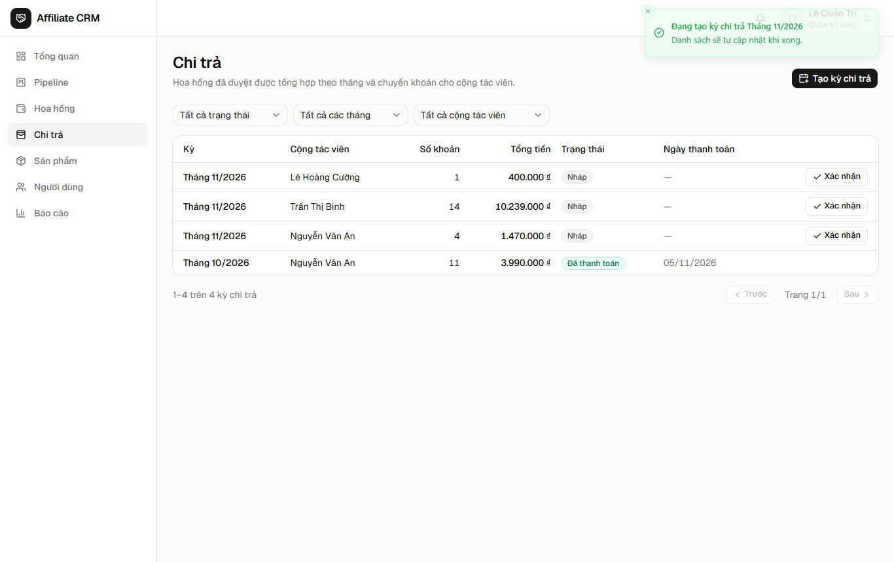
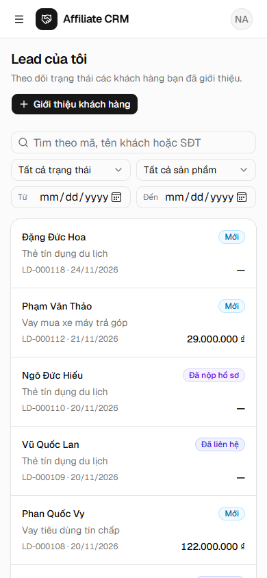
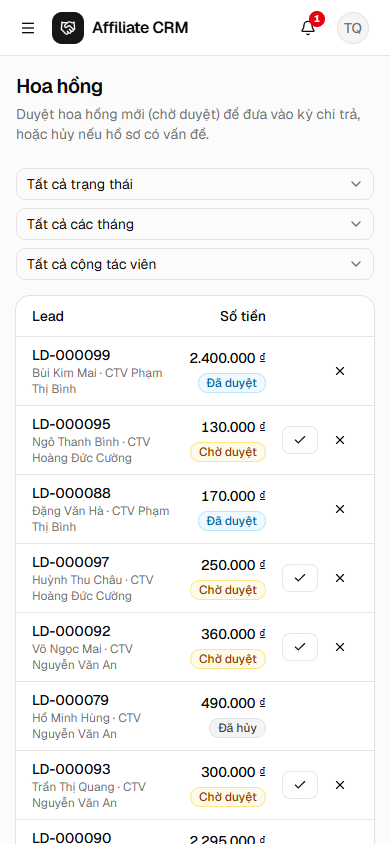
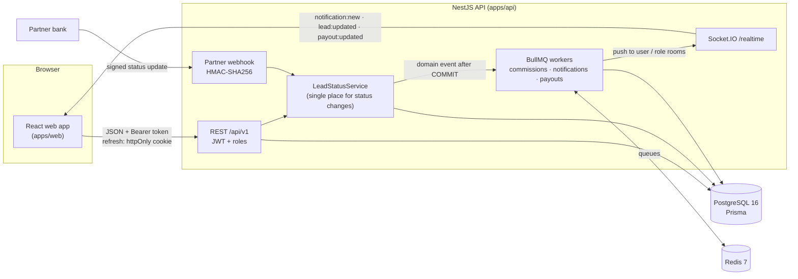
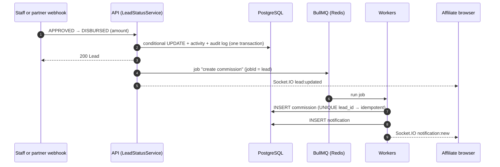

# Affiliate CRM

A mini CRM for an affiliate network (cộng tác viên) that refers customers for financial products — loans, credit cards, insurance. Affiliates submit leads, staff move them through a pipeline, partner banks push status updates by signed webhook, commissions are calculated automatically, payouts are generated monthly, and everyone gets realtime notifications.

Stack: NestJS 11 · TypeScript (strict) · Prisma 7 · PostgreSQL 16 · Redis 7 / BullMQ · Socket.IO · React · Vite · Docker · GitHub Actions.

Design docs: [architecture](docs/ARCHITECTURE.md) · [API contract](docs/api-contract.md) · [OpenAPI](docs/openapi.json) · [decision records](docs/decisions).

## Screenshots

The interface is in Vietnamese; all names and figures are demo data. Click an image for full size.

<table>
  <tr>
    <td width="50%"><a href="apps/web/docs/screenshots/m2-affiliate-dashboard.png"></a><br><sub><b>Affiliate dashboard</b>: commissions pending, approved and paid; recent leads; referral code</sub></td>
    <td width="50%"><a href="apps/web/docs/screenshots/m3-kanban-dragging.png"></a><br><sub><b>Pipeline (staff)</b>: drag a card to change the lead status; filters live in the URL</sub></td>
  </tr>
  <tr>
    <td><a href="apps/web/docs/screenshots/m3-lead-detail-staff.png"></a><br><sub><b>Lead detail</b>: status stepper, allowed transitions, assignment, internal notes, timeline</sub></td>
    <td><a href="apps/web/docs/screenshots/m4-reports.png"></a><br><sub><b>Reports (admin)</b>: KPIs, charts in Vietnam time with a table view, top affiliates</sub></td>
  </tr>
  <tr>
    <td><a href="apps/web/docs/screenshots/m4-notifications.png"></a><br><sub><b>Realtime notifications</b>: status changes and a new commission arrive over Socket.IO</sub></td>
    <td><a href="apps/web/docs/screenshots/m4-payouts-admin.png"></a><br><sub><b>Payouts (admin)</b>: generate a month (background job), confirm, mark paid</sub></td>
  </tr>
  <tr>
    <td colspan="2" align="center"><a href="apps/web/docs/screenshots/m2-leads-mobile.png"></a>&nbsp;&nbsp;&nbsp;<a href="apps/web/docs/screenshots/m4-commissions-mobile.png"></a><br><sub><b>Mobile</b>: an affiliate's leads and an admin approving commissions</sub></td>
  </tr>
</table>

## Architecture



What happens when a lead is disbursed:



## Features (backend)

- **Auth:** JWT access token (15 min) + rotating refresh token in an httpOnly `SameSite=Strict` cookie; reuse of an old refresh token revokes the whole session; argon2id passwords; rate limiting on `/auth`.
- **Roles and privacy:** ADMIN / STAFF / AFFILIATE guards on every route (secure by default); affiliates only see their own data, with customer phone and national ID masked.
- **Lead pipeline:** status machine (`NEW → CONTACTED → SUBMITTED → APPROVED → DISBURSED`, or `REJECTED`), optimistic concurrency (two people clicking at once → one gets 409), duplicate-referral protection, timeline, append-only audit log, accent-insensitive search ("nguyen" finds "Nguyễn"), Excel-friendly CSV export.
- **Commissions:** created by a background job when a lead is disbursed (percent in basis points or fixed VND, integer maths), idempotent, with a periodic reconcile job as a safety net; approve / cancel by admins.
- **Payouts:** monthly job groups approved commissions per affiliate; re-runnable; late approvals roll into the next month; confirm → paid marks commissions paid and notifies the affiliate.
- **Partner webhook:** HMAC over timestamp + raw body, 5-minute replay window, idempotent by `eventId`, partners only touch their own products' leads.
- **Realtime:** Socket.IO with the JWT checked at handshake, user and role rooms, disconnect when the token expires.
- **Reports:** SQL aggregates with per-day buckets in Vietnam time (Asia/Ho_Chi_Minh).
- **API quality:** OpenAPI 3 generated from the code (Swagger UI), machine-readable error codes, strict validation.

## Features (web)

React 19 · Vite · TypeScript (strict) · React Router · TanStack Query · react-hook-form + zod · Tailwind + shadcn/ui · Socket.IO client · Recharts · MSW · Vitest · Playwright.

- **One app, three roles:** affiliate, staff and admin each get their own menu and pages; route guards by role; responsive (drawer menu and card lists on phones).
- **Affiliates:** dashboard with commission totals and referral code; refer a customer (validated form, clear message for a duplicate referral); their own leads with masked phone and ID; commissions, payouts, and a bank account in the profile.
- **Pipeline:** kanban with drag and drop by mouse or keyboard (with screen-reader announcements), optimistic update and rollback when the server refuses (409 / invalid transition); a table view; search and filters (status, product, assignee, date range in Vietnam time) kept in the URL; lead detail with status stepper, assignment, internal notes and timeline.
- **Money:** admins approve or cancel commissions, generate a month of payouts (a background job; the list updates when it finishes), confirm and mark paid; products with percent or fixed commission; user management.
- **Realtime:** notification bell with unread count, toasts, and pages that refresh themselves on `lead:updated` / `payout:updated` (cache invalidation); the socket reconnects with a fresh token.
- **Reports:** KPI tiles, charts with a table view for each, top affiliates, date range presets.
- **Auth:** access token kept in memory and refreshed before it expires; the refresh token is an httpOnly cookie the code never sees; one refresh at a time, even across tabs.
- **Engineering:** API types generated from `docs/openapi.json`; error messages chosen by the API's error code; a full mock backend (MSW) so the whole app runs without the API; pages loaded on demand; an nginx Docker image with a CSP.

More detail: [apps/web/README.md](apps/web/README.md).

## Run with Docker Compose

Requirements: Docker. From the repo root:

```bash
# 1. Start Postgres, Redis, migrations, the API and the web app
#    (or put JWT_ACCESS_SECRET=... in a .env file next to docker-compose.yml)
export JWT_ACCESS_SECRET="$(openssl rand -base64 48)"   # PowerShell: $env:JWT_ACCESS_SECRET = "<32+ random chars>"
docker compose --profile app up -d --build

# 2. Load demo data (120 leads over 60 days, commissions, a paid payout)
docker compose --profile app run --rm migrate npx prisma db seed

# 3. Open the app at http://localhost:8080 and log in with a demo account below.
#    The web container's nginx also serves the API on the same origin:
curl http://localhost:8080/api/v1/health   # {"status":"ok","db":"up","redis":"up"}
#    Swagger UI: http://localhost:8080/api/docs

# Stop (data is kept in Docker volumes)
docker compose --profile app down
```

The API container is also published on `127.0.0.1:3000` (loopback only). Only infrastructure, for local development: `docker compose up -d postgres redis`, then see [apps/api/README.md](apps/api/README.md).

### Demo accounts

Password for all: `Demo@12345`

| Email | Role | What to try |
|---|---|---|
| `admin@demo.vn` | ADMIN | products, users, approve commissions, generate and pay payouts, reports |
| `staff@demo.vn` | STAFF | pipeline, assign leads, change status, internal notes |
| `ctv1@demo.vn` | AFFILIATE | own leads (masked PII), commissions, a paid payout, notifications |
| `ctv2@demo.vn`, `ctv3@demo.vn` | AFFILIATE | more data for reports |

Partner names in the demo data are fictional.

## Run the web app

Requires Node.js 22.12+ (developed on Node 26).

```bash
cd apps/web
npm ci

npm run dev:mock   # no backend needed: every API call is answered in the browser by MSW
npm run dev        # against the API from the Compose stack above (http://localhost:3000/api/v1)
```

Open http://localhost:5173 and sign in with a demo account above (in mock mode the login page has one-click buttons for them).

As a production build in Docker, nginx serves the app and forwards `/api/` and `/socket.io/` to the API, so the browser sees a single origin. `docker compose --profile app up` above already runs this image on http://localhost:8080. To run the image on its own next to a stack that has no web service:

```bash
docker build -t affiliate-crm-web apps/web
docker run --rm -p 8080:80 --network affiliate-crm_default affiliate-crm-web   # API_UPSTREAM defaults to http://api:3000
# open http://localhost:8080
```

Settings, environment variables and scripts: [apps/web/README.md](apps/web/README.md).

## End-to-end tests (web)

Playwright drives the real stack with two browsers at once, a new affiliate and a staff member / admin: every role signs in; the refresh cookie is httpOnly and survives a reload; then a lead is referred (a duplicate is refused), dragged across the kanban to DISBURSED while the affiliate watches the updates arrive live, its commission approved and paid out in a monthly payout; the reports page and the bank account form are checked last.

```bash
# needs the API with demo data on :3000 and `npm run dev` on :5173
cd apps/web
npm run e2e
# against the Docker image instead: E2E_BASE_URL=http://localhost:8080 npm run e2e
```

It uses an installed browser (Microsoft Edge by default, `E2E_CHANNEL=chrome` for Chrome) and never downloads one. Each run registers a new affiliate, so it can be repeated on the same database; it leaves that affiliate's lead, commission and paid payout behind.

## API documentation

- Swagger UI: http://localhost:8080/api/docs with Docker Compose, or http://localhost:3000/api/docs when running the API with `npm run start:dev` (raw JSON at `/api/docs-json`)
- Committed OpenAPI document: [docs/openapi.json](docs/openapi.json) — the web app generates its TypeScript types from it, and CI fails if it drifts from the code.

## Tests and CI

- API: 232 unit tests (pure logic) and 136 e2e tests against real Postgres and Redis (HTTP, Socket.IO client, BullMQ workers, signed webhooks); e2e covers ~97% of API source lines.
- GitHub Actions: [api workflow](.github/workflows/api.yml) — lint, typecheck, unit, e2e with service containers, OpenAPI drift check, Docker image build.
- Web: 187 Vitest + Testing Library tests (pages rendered with the real routes and providers against the MSW backend, plus pure logic) and 9 Playwright end-to-end tests against the real stack (above).
- GitHub Actions: [web workflow](.github/workflows/web.yml) — generated API types in sync with `docs/openapi.json`, lint, typecheck, format check, Vitest, production build, Docker image build. It runs only when `apps/web/**` or the contract changes (or by hand).

## Repository layout

```
apps/api      NestJS API — see apps/api/README.md
apps/web      React web app, its nginx Docker image and Playwright e2e — see apps/web/README.md
docs/         architecture, API contract, openapi.json, decision records
docker-compose.yml   postgres, redis (+ migrate, api, web with --profile app)
deploy/              production compose (Caddy → web nginx → api), Caddyfile, cloud-init, backups, IAM policies — see docs/deploy/aws.md
```
