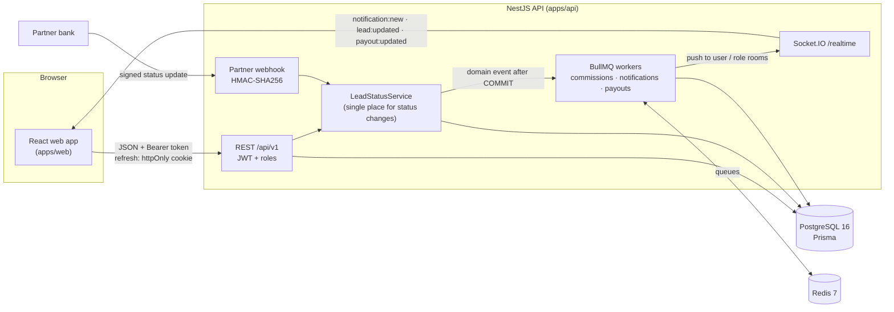
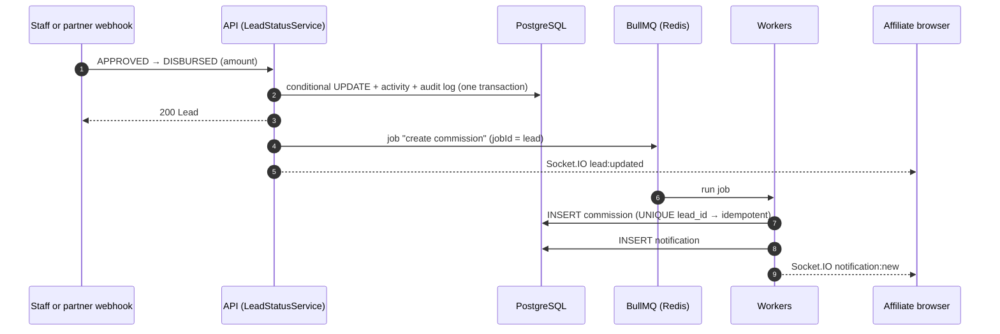

# Affiliate CRM

A mini CRM for an affiliate network (cộng tác viên) that refers customers for financial products — loans, credit cards, insurance. Affiliates submit leads, staff move them through a pipeline, partner banks push status updates by signed webhook, commissions are calculated automatically, payouts are generated monthly, and everyone gets realtime notifications.

Stack: NestJS 11 · TypeScript (strict) · Prisma 7 · PostgreSQL 16 · Redis 7 / BullMQ · Socket.IO · React · Vite · Docker · GitHub Actions.

Design docs: [architecture](docs/ARCHITECTURE.md) · [API contract](docs/api-contract.md) · [OpenAPI](docs/openapi.json) · [decision records](docs/decisions).

## Architecture



What happens when a lead is disbursed:



## Features (backend)

- **Auth:** JWT access token (15 min) + rotating refresh token in an httpOnly `SameSite=Strict` cookie; reuse of an old refresh token revokes the whole session; argon2id passwords; rate limiting on `/auth`.
- **Roles and privacy:** ADMIN / STAFF / AFFILIATE guards on every route (secure by default); affiliates only see their own data, with customer phone and national ID masked.
- **Lead pipeline:** status machine (`NEW → CONTACTED → SUBMITTED → APPROVED → DISBURSED`, or `REJECTED`), optimistic concurrency (two people clicking at once → one gets 409), duplicate-referral protection, timeline, append-only audit log, accent-insensitive search ("nguyen" finds "Nguyễn"), Excel-friendly CSV export.
- **Commissions:** created by a background job when a lead is disbursed (percent in basis points or fixed VND, integer maths), idempotent, with a periodic reconcile job as a safety net; approve / cancel by admins.
- **Payouts:** monthly job groups approved commissions per affiliate; re-runnable; late approvals roll into the next month; confirm → paid marks commissions paid and notifies the affiliate.
- **Partner webhook:** HMAC over timestamp + raw body, 5-minute replay window, idempotent by `eventId`, partners only touch their own products' leads.
- **Realtime:** Socket.IO with the JWT checked at handshake, user and role rooms, disconnect when the token expires.
- **Reports:** SQL aggregates with per-day buckets in Vietnam time (Asia/Ho_Chi_Minh).
- **API quality:** OpenAPI 3 generated from the code (Swagger UI), machine-readable error codes, strict validation.

## Run with Docker Compose

Requirements: Docker. From the repo root:

```bash
# 1. Start Postgres, Redis, migrations, the API and the web app
#    (or put JWT_ACCESS_SECRET=... in a .env file next to docker-compose.yml)
export JWT_ACCESS_SECRET="$(openssl rand -base64 48)"   # PowerShell: $env:JWT_ACCESS_SECRET = "<32+ random chars>"
docker compose --profile app up -d --build

# 2. Load demo data (120 leads over 60 days, commissions, a paid payout)
docker compose --profile app run --rm migrate npx prisma db seed

# 3. Open the app at http://localhost:8080 and log in with a demo account below.
#    The web container's nginx also serves the API on the same origin:
curl http://localhost:8080/api/v1/health   # {"status":"ok","db":"up","redis":"up"}
#    Swagger UI: http://localhost:8080/api/docs

# Stop (data is kept in Docker volumes)
docker compose --profile app down
```

The API container is also published on `127.0.0.1:3000` (loopback only). Only infrastructure, for local development: `docker compose up -d postgres redis`, then see [apps/api/README.md](apps/api/README.md).

### Demo accounts

Password for all: `Demo@12345`

| Email | Role | What to try |
|---|---|---|
| `admin@demo.vn` | ADMIN | products, users, approve commissions, generate and pay payouts, reports |
| `staff@demo.vn` | STAFF | pipeline, assign leads, change status, internal notes |
| `ctv1@demo.vn` | AFFILIATE | own leads (masked PII), commissions, a paid payout, notifications |
| `ctv2@demo.vn`, `ctv3@demo.vn` | AFFILIATE | more data for reports |

Partner names in the demo data are fictional.

## API documentation

- Swagger UI: http://localhost:8080/api/docs with Docker Compose, or http://localhost:3000/api/docs when running the API with `npm run start:dev` (raw JSON at `/api/docs-json`)
- Committed OpenAPI document: [docs/openapi.json](docs/openapi.json) — the web app generates its TypeScript types from it, and CI fails if it drifts from the code.

## Tests and CI

- API: 232 unit tests (pure logic) and 136 e2e tests against real Postgres and Redis (HTTP, Socket.IO client, BullMQ workers, signed webhooks); e2e covers ~97% of API source lines.
- GitHub Actions: [api workflow](.github/workflows/api.yml) — lint, typecheck, unit, e2e with service containers, OpenAPI drift check, Docker image build.

## Repository layout

```
apps/api      NestJS API — see apps/api/README.md
apps/web      React web app — see apps/web/README.md
docs/         architecture, API contract, openapi.json, decision records
docker-compose.yml   postgres, redis (+ migrate, api with --profile app)
```
