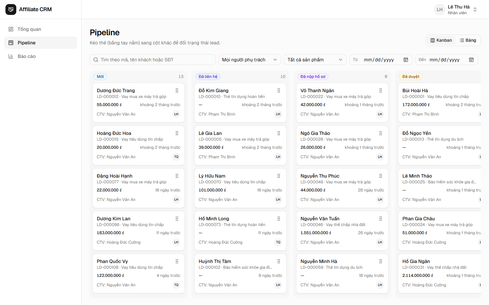
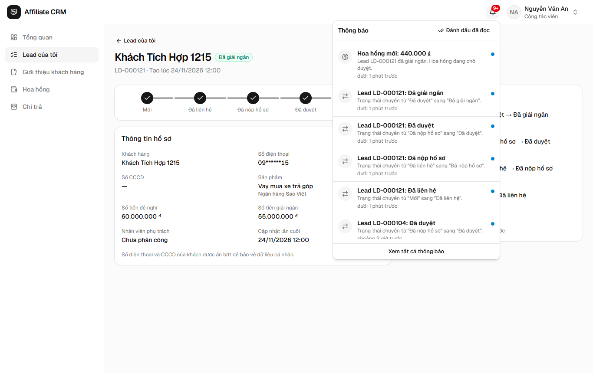

# Affiliate CRM — Web

React frontend for the Affiliate CRM: one app for three roles (affiliate, staff, admin), Vietnamese UI, works on phones.

Stack: Vite 8 · React 19 · TypeScript (strict) · React Router 8 · TanStack Query · react-hook-form + zod · Tailwind CSS 4 + shadcn/ui · MSW · Vitest + Testing Library.

| Pipeline (kanban)                                           | Lead detail (staff)                         | Affiliate dashboard                                     | Mobile                                                   |
| ----------------------------------------------------------- | ------------------------------------------- | ------------------------------------------------------- | -------------------------------------------------------- |
|  |  |  |  |

## Features so far

- **Auth** (M1): login, affiliate sign-up, role-based layout and menu, route guards, automatic token refresh (also before expiry, from `expiresIn`).
- **Affiliate area** (M2): dashboard (commission totals, conversion, recent leads, referral code), leads list with search / status / product / date filters kept in the URL, create-lead form (loan amount only for loans, duplicate-lead message), lead detail with progress stepper and timeline, commissions, payouts. Customer phone and ID are masked for affiliates.
- **Staff and admin** (M3): pipeline as a **kanban board with drag-and-drop** (mouse, touch, keyboard) or a table, filter by assignee (mine / unassigned / person); lead actions (next status with amount or reason, assign, internal notes) with optimistic updates and 409 handling; admin **products** (pause/resume, create/edit commission rules) and **users** (create staff, edit, lock/unlock).
- **Realtime and admin finance** (M4): live notifications over Socket.IO (bell with unread count, notifications page, toasts that open the lead), lead and payout updates refresh open pages without reload; admin approves/cancels commissions and generates, confirms and pays monthly payouts; reports with Recharts (lazy-loaded); profile page with the affiliate's bank account; tables checked at phone width.

## Run it

Requires Node.js 22.12+ (developed on Node 26).

```bash
cd apps/web
npm ci

npm run dev:mock   # no backend needed: the API is answered by MSW in the browser
npm run dev        # against the real API at VITE_API_URL (default http://localhost:3000/api/v1)
```

Open http://localhost:5173. Demo accounts (password `Demo@12345`): `admin@demo.vn`, `staff@demo.vn`, `ctv1@demo.vn` … `ctv3@demo.vn`. In dev/mock mode the login page has one-click buttons for them.

| Script                            | What it does                                                |
| --------------------------------- | ----------------------------------------------------------- |
| `npm run dev` / `dev:mock`        | Dev server (real API / mock API)                            |
| `npm test`                        | Vitest, once (`test:watch` for watch mode)                  |
| `npm run lint`                    | ESLint                                                      |
| `npm run typecheck`               | `tsc -b`                                                    |
| `npm run format` / `format:check` | Prettier                                                    |
| `npm run build` / `build:mock`    | Production build to `dist/` (real API / mock API demo)      |
| `npm run gen:api`                 | Regenerate `src/api/schema.gen.ts` from `docs/openapi.json` |

### Environment variables

Copy `.env.example` to `.env.local`.

| Variable          | Default                        | Meaning                                           |
| ----------------- | ------------------------------ | ------------------------------------------------- |
| `VITE_API_URL`    | `http://localhost:3000/api/v1` | API base URL                                      |
| `VITE_USE_MOCKS`  | `false`                        | `true` = answer API calls with MSW in the browser |
| `VITE_SOCKET_URL` | origin of `VITE_API_URL`       | Socket.IO server (namespace `/realtime`)          |

## Code map

```
src/
  api/          typed API client: generated + hand-written types, fetch wrapper, token store, refresh
  auth/         AuthProvider (current user via TanStack Query), route guards, role labels
  features/     one folder per area: pages, query hooks (TanStack Query keys) and their tests
    auth/ dashboard/ leads/ finance/ catalog/ users/ notifications/ reports/ profile/
  realtime/     Socket.IO connection (and the mock one), RealtimeBridge
  components/   layout, form fields, status badges, pagination, shadcn/ui primitives in ui/
  lib/          formatting (VND, Vietnam time), Vietnam calendar helpers, labels, validation, URL state
  mocks/        MSW handlers + in-memory DB seeded like the contract's "Seed data"
  pages/        generic screens (placeholder, route error)
  test/         Vitest setup and render helpers
  routes.tsx    route tree with guards
```

## How auth works

- Access token in memory, refresh token in `localStorage`. On a 401 the client refreshes once (shared by concurrent requests and serialized across tabs) and retries. Details and trade-offs: [docs/decisions/001-web-auth-token-storage.md](../../docs/decisions/001-web-auth-token-storage.md).
- Route guards: `<RequireAuth>` (redirect to `/login` and back), `<RequireRole>` (403 screen), `<GuestOnly>` (login/register). They are UX only; the API enforces the same rules.
- The sidebar menu is defined per role in `src/lib/navigation.ts`; a test checks that every menu link opens for its roles.

## Tests

Tests render the real app (routes, guards, providers) and talk to the MSW mock API through `fetch`, so the API client, guards and forms are tested together. See [docs/decisions/002-web-msw-mock-api.md](../../docs/decisions/002-web-msw-mock-api.md).

## Conventions

- Money is VND integers, shown as `1.500.000 ₫`; dates are shown in Vietnam time (`Asia/Ho_Chi_Minh`).
- UI text in Vietnamese; code, comments and docs in English.
- API types: import from `src/api/types.ts` only. It re-exports types generated from `docs/openapi.json` and adds hand-written ones for endpoints not exported yet. See [docs/decisions/004-web-generated-api-types.md](../../docs/decisions/004-web-generated-api-types.md).
- List filters and the page number live in the URL (`useUrlState`), so they survive reloads and the back button.
- Business errors are shown by their `code` (the OpenAPI `ErrorCode` enum) with Vietnamese messages (`src/api/errors.ts`); a new code fails the type check until it has a message.
- Realtime: one connection per session; events invalidate the query cache. See [docs/decisions/006-web-realtime.md](../../docs/decisions/006-web-realtime.md).
- Kanban drag-and-drop and optimistic status changes: [docs/decisions/005-web-kanban-optimistic-status.md](../../docs/decisions/005-web-kanban-optimistic-status.md).
