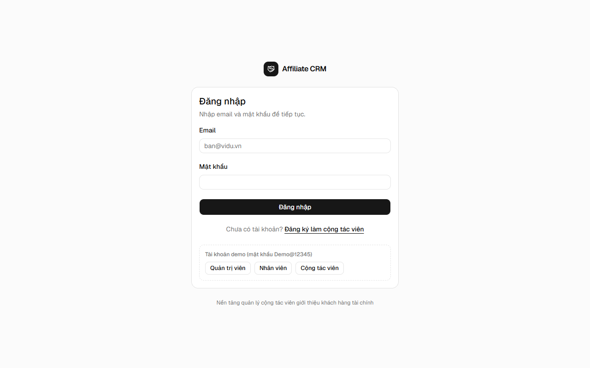

# Affiliate CRM — Web

React frontend for the Affiliate CRM: one app for three roles (affiliate, staff, admin), Vietnamese UI, works on phones.

Stack: Vite 8 · React 19 · TypeScript (strict) · React Router 8 · TanStack Query · react-hook-form + zod · Tailwind CSS 4 + shadcn/ui · MSW · Vitest + Testing Library.



## Run it

Requires Node.js 22.12+ (developed on Node 26).

```bash
cd apps/web
npm ci

npm run dev:mock   # no backend needed: the API is answered by MSW in the browser
npm run dev        # against the real API at VITE_API_URL (default http://localhost:3000/api/v1)
```

Open http://localhost:5173. Demo accounts (password `Demo@12345`): `admin@demo.vn`, `staff@demo.vn`, `ctv1@demo.vn` … `ctv3@demo.vn`. In dev/mock mode the login page has one-click buttons for them.

| Script                            | What it does                                           |
| --------------------------------- | ------------------------------------------------------ |
| `npm run dev` / `dev:mock`        | Dev server (real API / mock API)                       |
| `npm test`                        | Vitest, once (`test:watch` for watch mode)             |
| `npm run lint`                    | ESLint                                                 |
| `npm run typecheck`               | `tsc -b`                                               |
| `npm run format` / `format:check` | Prettier                                               |
| `npm run build` / `build:mock`    | Production build to `dist/` (real API / mock API demo) |

### Environment variables

Copy `.env.example` to `.env.local`.

| Variable         | Default                        | Meaning                                           |
| ---------------- | ------------------------------ | ------------------------------------------------- |
| `VITE_API_URL`   | `http://localhost:3000/api/v1` | API base URL                                      |
| `VITE_USE_MOCKS` | `false`                        | `true` = answer API calls with MSW in the browser |

## Code map

```
src/
  api/          typed API client: types from the contract, fetch wrapper, token store, refresh logic
  auth/         AuthProvider (current user via TanStack Query), route guards, role labels
  components/   layout (sidebar, topbar, user menu), form fields, shadcn/ui primitives in ui/
  lib/          formatting (VND, Vietnam time), validation schemas, navigation per role, query client
  mocks/        MSW handlers + in-memory DB seeded like the contract's "Seed data"
  pages/        route screens
  test/         Vitest setup and render helpers
  routes.tsx    route tree with guards
```

## How auth works

- Access token in memory, refresh token in `localStorage`. On a 401 the client refreshes once (shared by concurrent requests and serialized across tabs) and retries. Details and trade-offs: [docs/decisions/001-web-auth-token-storage.md](../../docs/decisions/001-web-auth-token-storage.md).
- Route guards: `<RequireAuth>` (redirect to `/login` and back), `<RequireRole>` (403 screen), `<GuestOnly>` (login/register). They are UX only; the API enforces the same rules.
- The sidebar menu is defined per role in `src/lib/navigation.ts`; a test checks that every menu link opens for its roles.

## Tests

Tests render the real app (routes, guards, providers) and talk to the MSW mock API through `fetch`, so the API client, guards and forms are tested together. See [docs/decisions/002-web-msw-mock-api.md](../../docs/decisions/002-web-msw-mock-api.md).

## Conventions

- Money is VND integers, shown as `1.500.000 ₫`; dates are shown in Vietnam time (`Asia/Ho_Chi_Minh`).
- UI text in Vietnamese; code, comments and docs in English.
- API types live in `src/api/types.ts`, written from `docs/api-contract.md`; they will be generated with `openapi-typescript` once `docs/openapi.json` exists.
