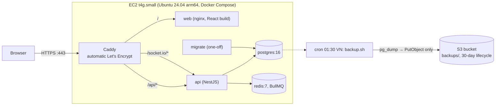

# Deploying Affiliate CRM on AWS — plan

> **Status: plan only.** Nothing has been created on AWS and no AWS API was called. The owner decides whether and when to deploy.
>
> Prices: **Asia Pacific (Singapore), `ap-southeast-1`**, On-Demand, USD, from AWS's own price lists and pages, **checked 2026-11-24** (sources at the end). A month is counted as 730 hours. Prices change; re-check before launching.

## TL;DR

- **Recommended: option A**: one small Graviton VM (EC2 `t4g.small`, 2 vCPU / 2 GiB). It runs the whole app with Docker Compose: Caddy (automatic HTTPS), the API, the web app, PostgreSQL and Redis. A daily `pg_dump` is copied to S3. **About US$21 per month.**
- On a **new AWS account using the Free plan**, `t4g.small` is an eligible instance type and the cost is paid from the sign-up credits ($100, up to $200). Those credits cover the six months the Free plan lasts. AWS's documentation says the Free plan **does not charge your card** unless you upgrade to the Paid plan.
- **To stop paying:** terminate the instance, **release the Elastic IP**, delete the volume and any snapshots, and empty the bucket. See [section 7](#7-cost-and-how-to-shut-down-chi-phí-và-cách-tắt).

## 1. Free tier and credits for new accounts (as of 2026-11-24)

Source: AWS Billing docs "Explore AWS services with AWS Free Tier", the AWS Free Tier page and FAQs, and the EC2 Free Tier usage docs.

- **Credits:** US$100 on sign-up, plus up to US$100 more for completing activities at US$20 each: launch an EC2 instance, set up a cost budget, create an RDS database, build a Lambda web app, create a DynamoDB table, or try the Bedrock playground. This plan earns the first two of those just by following the checklist.
- **Free account plan:**
  - Lasts up to **6 months** or until the credits run out, whichever comes first.
  - "You will not incur any charges during this period until you upgrade to a paid account plan."
  - Only some services are available. EC2 and S3 are among them.
  - EC2 instance types allowed on the Free plan (for accounts created on or after 2025-07-15): `t3.micro`, `t3.small`, `t4g.micro`, **`t4g.small`**, `c7i-flex.large` and `m7i-flex.large`.
- **When the Free plan ends**, the account is suspended unless you upgrade. AWS keeps the data for **90 days**, then erases the account. **Download a backup before that.**
- **Paid plan:** you get the same credits, then normal pay-as-you-go prices.
- **Always free, on every plan:** 100 GB per month of data transfer out to the internet, counted across all services. This demo will not get close to that.
- **Older accounts** (created before 2025-07-15) are still on the old 12-month free tier (`t2.micro` / `t3.micro`), and the credits above do not apply to them.
- **AWS Budgets:** "monitor and receive notifications on your budgets free of charge."

## 2. Options compared

| | A. One EC2 VM + Docker Compose + Caddy | B. Lightsail VM | C. ECS Fargate + RDS + ElastiCache + ALB |
|---|---|---|---|
| **Cost per month (estimate)** | **≈ $21** | **≈ $12–15** | **≈ $105** |
| What you pay for | `t4g.small` $15.48 + 20 GB gp3 $1.92 + public IPv4 $3.65 + S3 backups ≈ $0.03 | $12 bundle (2 vCPU, 2 GB, 60 GB SSD, 3 TB transfer, static IPv4 included) + optional snapshots ($0.05/GB-month) | API task $22.49 + web task $11.25 + RDS $21.01 + ElastiCache $14.02 + ALB ≈ $22–24 + 4 public IPv4 $14.60 |
| New-account Free plan | **Yes**: `t4g.small` is eligible, about 4.7 months on $100 and the whole 6 months with $200; no card charges | Lightsail isn't listed among the Free plan offers; its pricing page says only "you can get started with Amazon Lightsail for free" without terms. Third-party guides mention 3 free months on the $5/$7/$12 bundles; **not confirmed on an AWS page** | Credits last under 2 months; ECS, ElastiCache and ELB are probably Paid-plan only (not confirmed) |
| How much work | Medium: Linux, Docker, security group, IAM role, DNS | Low: console wizard, fixed price | High: VPC, task definitions, secrets, roles, ALB, health checks; realistically needs Terraform or CDK |
| What it shows in a CV or interview | Running containers in production yourself; HTTPS reverse proxy; least-privilege IAM (instance role that can only write backups); backup and restore drill; cost control | "I shipped it" with a fixed price; few AWS-specific skills | Managed AWS building blocks (ECS, Fargate, RDS, ElastiCache, ALB), the kind of stack job ads list; the cost is hard to justify for a demo |
| Main risk | One machine: no redundancy, you patch the OS yourself (security updates are automatic) | The same, with less control and a smaller ecosystem | The bill: idle cost alone is about $3.50/day |

How each estimate was calculated (Singapore On-Demand, 730 hours):

- **A:** EC2 `t4g.small` $0.0212/h → $15.48; EBS gp3 $0.096/GB-month × 20 → $1.92; public IPv4 $0.005/h → $3.65; S3 Standard $0.025/GB-month for about 1 GB of dumps → $0.03.
  - A cheaper variant on `t4g.micro` (1 GiB, $0.0106/h) comes to about $13.3, but 1 GiB is too tight for Postgres, Redis, the API and the build.
- **B:** the Lightsail $12 bundle; Singapore's transfer allowance is not one of the halved regions.
- **C:**
  - Fargate (x86) $0.05056 per vCPU-hour and $0.00553 per GB-hour: API task 0.5 vCPU / 1 GB → $22.49; web task 0.25 vCPU / 0.5 GB → $11.25.
  - RDS PostgreSQL `db.t4g.micro` Single-AZ $0.025/h → $18.25, plus 20 GB gp3 at $0.138 → $2.76.
  - ElastiCache Valkey `cache.t4g.micro` $0.0192/h → $14.02.
  - ALB $0.0252/h → $18.40, plus LCUs at $0.008/LCU-hour.
  - Public IPv4 for 2 ALB addresses and 2 tasks → $14.60. Private subnets would need a NAT gateway, which costs more.
  - CloudWatch Logs and ECR come on top.

## 3. Recommendation

**Option A on a new account's Free plan in Singapore.**

- **Budget:** for a job seeker with little money, it costs **$0 out of pocket for up to 6 months**, and AWS's own documentation says the Free plan cannot charge the card.
- **Skills:** it shows real operations work. You can explain every part:
  - TLS termination;
  - one-origin routing, which keeps the `SameSite=Strict` refresh cookie working;
  - least-privilege IAM;
  - restoring from backups;
  - why it is not highly available, and what would change at scale (option C).
- **Reuse:** it uses the Dockerfiles and Compose setup that CI already builds, without rewriting anything.
- **Fallback:** if the account is not eligible for credits (an old account), Lightsail's $12 bundle (B) is the cheapest predictable choice and the same `deploy/` files run there unchanged.

## 4. Architecture of option A



- **One origin.** The web app, the API and Socket.IO share one domain, so the `crm_rt` cookie can be `Secure; SameSite=Strict` and CORS is not needed for the browser app.
- **What is exposed.** Only Caddy publishes ports (80 and 443). Postgres and Redis are reachable only inside the Compose network.
- **Proxy settings.** The API runs with `TRUST_PROXY=1`, so the per-IP rate limit on `/auth` sees the real client IP rather than Caddy's, and with `COOKIE_SECURE=true`.

## 5. Files

| File | Purpose |
|---|---|
| [`deploy/compose.prod.yml`](../../deploy/compose.prod.yml) | caddy, web (TODO until crm-web's Dockerfile exists), api, migrate, postgres, redis; memory limits; nothing but Caddy exposed |
| [`deploy/Caddyfile`](../../deploy/Caddyfile) | HTTPS, routing `/api/*` and `/socket.io/*` → api, everything else → web, security headers |
| [`deploy/cloud-init.yml`](../../deploy/cloud-init.yml) | EC2 user data: updates, 2 GB swap, Docker from its apt repository, log rotation, AWS CLI v2, backup cron |
| [`deploy/.env.prod.example`](../../deploy/.env.prod.example) | every setting the server needs, with placeholder values only |
| [`deploy/backup.sh`](../../deploy/backup.sh) / [`deploy/restore.sh`](../../deploy/restore.sh) | daily `pg_dump` → check → S3; interactive restore |
| [`deploy/iam/deployer-policy.json`](../../deploy/iam/deployer-policy.json) | limited IAM user: EC2 only in Singapore and only `t4g.small`/`t4g.micro`, no reserved-instance purchases, only the backup bucket, cost views |
| [`deploy/iam/instance-backup-policy.json`](../../deploy/iam/instance-backup-policy.json) | the EC2 role may **only** `PutObject` to `backups/*` (it cannot read or delete backups) |
| [`deploy/iam/s3-backup-lifecycle.json`](../../deploy/iam/s3-backup-lifecycle.json) | backups expire after 30 days |

Already validated locally:

- `docker compose config` accepts `compose.prod.yml`, and it fails clearly when a required variable is missing.
- `caddy validate` and `caddy fmt` pass on the Caddyfile.
- The cloud-init YAML and IAM JSON files parse, and `bash -n` passes on both scripts.
- The `runtime` and `migrate` images were built and run against Postgres and Redis in M5.

**Not run yet:** the whole production stack together behind Caddy, and anything on AWS.

## 6. Setup checklist (manual, in the AWS console)

Do these in order. Region: **Asia Pacific (Singapore)**.

**Account and access**
- [ ] Create the account (new e-mail → eligible for credits) and choose the **Free account plan**.
- [ ] Root user: turn on **MFA** and do not create access keys. Use root only for account-level settings.
- [ ] As root, under Account → *IAM user and role access to Billing information*, turn it on so the IAM user can see costs.
- [ ] Create IAM user `crm-admin` with console access and **MFA**, and attach a customer-managed policy made from `deploy/iam/deployer-policy.json`. Replace `REPLACE_ACCOUNT_ID` and `REPLACE_BACKUP_BUCKET` first. Sign out of root and work as this user. (IAM Identity Center is the more modern alternative, but more setup for one person.)

**Cost guardrails**
- [ ] AWS Budgets → *Monthly cost budget* of **$5**, with e-mail alerts at 50%, 80% and 100% of actual cost and at 100% of forecast. This is free and earns a $20 credit. On the Paid plan, set it just above the expected $21.
- [ ] Optionally, Billing → *Free Tier* page to see remaining credits.

**Backups**
- [ ] S3 → create bucket `affiliate-crm-backups-<random>` in Singapore. Keep *Block all public access* on and the default SSE-S3 encryption.
- [ ] Add the lifecycle rule from `deploy/iam/s3-backup-lifecycle.json`, either in the console (Management → Lifecycle rules) or with `aws s3api put-bucket-lifecycle-configuration`.
- [ ] IAM → create role `affiliate-crm-ec2` (trusted entity: EC2) with an inline policy from `deploy/iam/instance-backup-policy.json`. Optionally also attach `AmazonSSMManagedInstanceCore` to use Session Manager instead of SSH.

**Network and server**
- [ ] Security group `affiliate-crm-web`, inbound:
  - TCP 80 and 443 from `0.0.0.0/0` and `::/0`;
  - UDP 443 (HTTP/3), optional;
  - **TCP 22 only from `<your-public-IP>/32`**, or none at all if you use Session Manager.
- [ ] Launch the instance:
  - **Ubuntu Server 24.04 LTS (64-bit Arm)** on `t4g.small`;
  - 20 GB gp3 root volume with *Delete on termination* = yes;
  - IAM role `affiliate-crm-ec2`, security group `affiliate-crm-web`;
  - *Metadata version* = **IMDSv2 only**;
  - *User data* = contents of `deploy/cloud-init.yml`;
  - a key pair (or none with Session Manager).
  This earns a $20 credit.
- [ ] Elastic IP → allocate and **associate** it with the instance. Note that it is billed even while not attached; see section 7.

**Domain and HTTPS**
- [ ] Get a hostname: a cheap domain, or a free subdomain such as `<name>.duckdns.org`. Create an **A record** pointing to the Elastic IP. Route 53 is not required.
- [ ] Wait until `nslookup <domain>` returns the Elastic IP. Caddy requests the certificate on first start.

**Deploy**
- [ ] SSH or Session Manager into the instance. Then:
  ```bash
  git clone <repo-url> /opt/affiliate-crm && cd /opt/affiliate-crm/deploy
  cp .env.prod.example .env.prod && nano .env.prod   # DOMAIN, ACME_EMAIL, secrets, bucket
  chmod 600 .env.prod
  docker compose -f compose.prod.yml --env-file .env.prod up -d --build
  docker compose -f compose.prod.yml --env-file .env.prod run --rm migrate npx prisma db seed   # demo data
  ```
  The first build takes several minutes on a 2 GB machine; the swap file prevents out-of-memory failures.
- [ ] Check:
  - `https://<domain>/api/v1/health` returns `{"status":"ok","db":"up","redis":"up"}`;
  - `https://<domain>/api/docs` opens Swagger;
  - logging in sets `Set-Cookie: crm_rt=…; Secure; HttpOnly; SameSite=Strict`.
- [ ] **Backup drill:** run `sudo ./backup.sh`, confirm the object appears in S3, then download it to your machine and run `./restore.sh` against a test copy once.

**Updates later:** `git pull && docker compose -f compose.prod.yml --env-file .env.prod up -d --build`. Migrations run automatically through `migrate`.

## 7. Cost and how to shut down (Chi phí và cách tắt)

**What it costs while running (option A, Singapore):**

| Item | Per day | Per month |
|---|---|---|
| EC2 `t4g.small` | $0.51 | $15.48 |
| EBS gp3 20 GB | $0.06 | $1.92 |
| Public IPv4 (Elastic IP) | $0.12 | $3.65 |
| S3 backups (~1 GB, 30-day retention) | ~$0 | ~$0.03 |
| Data out (under 100 GB/month) | $0 | $0 |
| **Total** | **≈ $0.70** | **≈ $21** |

- **On the Free plan:** credits pay for this; no card charge is possible. $100 lasts about 4.7 months; with the extra activity credits, the full 6 months.
- **On the Paid plan, or after upgrading:** this is a real bill. Keep the $5 or $25 budget alert on.
- The domain (if bought) is paid to the registrar, not to AWS.

**Pause (keep everything, small cost): about $5.60/month**

- *Stop* the instance (EC2 → Instance state → Stop). Compute is no longer charged.
- Still charged: the **EBS volume ($1.92)** and the **Elastic IP ($3.65)**.
- Start it again any time; the IP and data stay.

**Delete everything (back to $0)**, in this order:

1. Take a final backup: `sudo ./backup.sh`, then copy the dump to your own computer.
2. EC2 → **Terminate** the instance. With *Delete on termination*, the root volume goes too.
3. EC2 → Volumes: the list must be empty; delete any leftover volume.
4. EC2 → Elastic IPs → **Release** the address. This is the charge people forget, because AWS bills **idle** IPv4 addresses too.
5. EC2 → Snapshots and AMIs: delete any you made.
6. S3 → empty and delete the bucket (or keep a few dumps for cents per month).
7. Optionally delete the security group and the IAM role (both free).
8. Check every region at once in EC2 → *EC2 Global View*, and the next day in Billing → *Bills*. Spending should be flat.

The same steps from a terminal, if you set up the AWS CLI on your own machine:

```bash
aws ec2 terminate-instances --instance-ids i-xxxxxxxx --region ap-southeast-1
aws ec2 release-address --allocation-id eipalloc-xxxxxxxx --region ap-southeast-1
aws ec2 describe-volumes --region ap-southeast-1 --query 'Volumes[].VolumeId'   # expect []
aws s3 rb s3://affiliate-crm-backups-xxxx --force                               # deletes the backups too
```

**End of the Free plan (6 months):** the account is suspended, then erased after 90 days unless you upgrade. Either export a backup and let it lapse, or upgrade (about $21/month for A, or move to Lightsail at $12/month).

## 8. Limits and next steps

- **Single machine:** no high availability. A reboot or crash means a few minutes of downtime. Backups run daily, so up to 24 hours of data can be lost; that is acceptable for a demo and worth naming in an interview.
- **Building on the server** is slow on 2 GB. Better: let GitHub Actions build arm64 images and push them to GHCR, so the server only pulls them. The CI already builds the images; it needs a push step and the owner's decision about a public registry.
- **Terraform or CDK** for the checklist above, so the stack can be created and destroyed in one command.
- **Scaling path:** option C. Postgres moves to RDS and Redis to ElastiCache. The API runs as several Fargate tasks behind an ALB, which needs `@socket.io/redis-adapter` and sticky sessions for Socket.IO. Migrations run as a one-off ECS task, as the `migrate` target already does.

## Sources (checked 2026-11-24)

- AWS Billing docs, *Explore AWS services with AWS Free Tier*: https://docs.aws.amazon.com/awsaccountbilling/latest/aboutv2/free-tier.html
- AWS Billing docs, *Earning additional credits*: https://docs.aws.amazon.com/awsaccountbilling/latest/aboutv2/free-tier-plans-activities.html
- AWS Free Tier page and FAQs: https://aws.amazon.com/free/ and https://aws.amazon.com/free/free-tier-faqs/
- AWS What's New, July 2025, *AWS Free Tier now offers $200 in credits and 6-month free plan*: https://aws.amazon.com/about-aws/whats-new/2025/07/aws-free-tier-credits-month-free-plan
- EC2 docs, *Track your Free Tier usage for Amazon EC2* (Free-plan instance types): https://docs.aws.amazon.com/AWSEC2/latest/UserGuide/ec2-free-tier-usage.html
- EC2 On-Demand prices, Singapore: the price data behind https://aws.amazon.com/ec2/pricing/on-demand/ (published 2026-11-23); 100 GB/month free data transfer out is stated on the same page
- EBS gp3, RDS, ElastiCache, ELB, S3 and Fargate prices: AWS Price List files `https://pricing.us-east-1.amazonaws.com/offers/v1.0/aws/<Service>/current/ap-southeast-1/index.csv` (published 2026-11-11 to 2026-11-23)
- VPC pricing (public IPv4 $0.005/hour, in use or idle): https://aws.amazon.com/vpc/pricing/
- Lightsail pricing: https://aws.amazon.com/lightsail/pricing/
- AWS Budgets pricing: https://aws.amazon.com/aws-cost-management/aws-budgets/pricing/
